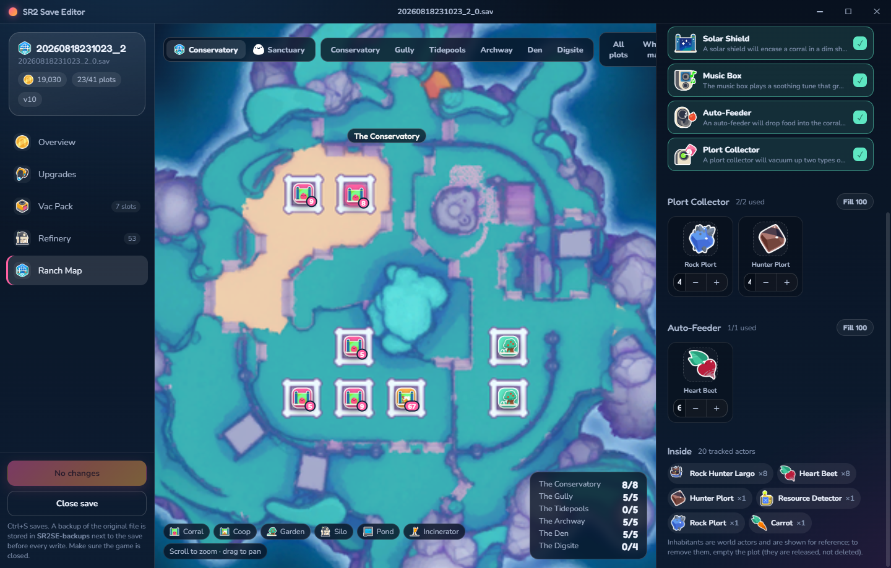

# Slime Rancher 2 Save Editor (SR2SE)

[](https://github.com/Microb4ek/SlimeRancher2-save-editor-SR2SE/actions/workflows/build.yml)
[](https://github.com/Microb4ek/SlimeRancher2-save-editor-SR2SE/releases/latest)

A desktop save editor for **Slime Rancher 2** — Windows and SteamOS / Steam Deck (Linux AppImage). Built with Electron + React + TypeScript, using the game's own icons and map art.



## Features

- **Money & rancher stats** — Newbucks (also fixed in the load-screen summary), health, energy, radiation, keys
- **Upgrades** — all 15 vac-pack upgrade lines with their real icons and level names (Tank Booster I–VIII, Heart Module, Jetpack, Golden / Shadow Sureshot, …) plus the upgrade components you carry; slot count follows Extra Tank / Water Tank automatically
- **Vac Pack** — put any item into any slot with a searchable, categorised picker (slimes, plorts, food, animals, resources, toys), edit counts, toggle radiant slimes
- **Refinery / storage** — every plort, crafting resource and stored gadget, add or remove entries
- **Interactive ranch map** — the game's map of Rainbow Fields / The Conservatory and The Sanctuary with all 41 plots. Click a plot to change its type (corral, coop, garden, silo, pond, incinerator), the crop, every plot upgrade, feeder / plort-collector / silo contents — and see which slimes, largos, chickens and crops currently live there
- **Progress detection** — everything above is read from the save itself: built plots per area, purchased upgrades, contents, inhabitants
- **Safety** — the editor re-parses its own output before writing and stores a copy of the original in `SR2SE-backups/` next to the save on every write

## Download

Grab the latest build from the [Releases](https://github.com/Microb4ek/SlimeRancher2-save-editor-SR2SE/releases/latest) page:

| File | Platform |
| --- | --- |
| `SR2 Save Editor-<version>-portable.exe` | Windows, no install |
| `SR2 Save Editor-<version>-setup.exe` | Windows installer |
| `SR2-Save-Editor-<version>-x86_64.AppImage` | SteamOS / Steam Deck / any Linux |

## Where the saves are

**Windows**

```
C:\Users\<you>\AppData\LocalLow\MonomiPark\SlimeRancher2\Steam\<Steam ID>\
```

**SteamOS / Linux** (Proton prefix; the editor scans every Steam library, SD card included)

```
~/.steam/steam/steamapps/compatdata/1657630/pfx/drive_c/users/steamuser/AppData/LocalLow/MonomiPark/SlimeRancher2/Steam/<Steam ID>/
```

Files are named `YYYYMMDDHHMMSS_<slot>_<n>.sav`. `_0` is the current save; `_1`…`_5` are the game's own rolling backups. The editor lists the current saves first and can show the backups too.

Close the game before editing. After saving, start the game; if Steam reports a cloud conflict pick the **local** (newer) file.

### Steam Deck

1. Switch to Desktop Mode, download the `.AppImage`, right-click → Properties → Permissions → *Is executable* (or `chmod +x` it).
2. Run it. It finds the save automatically; the trackpads act as a mouse, `Steam + X` opens the keyboard.
3. Optional: add the AppImage as a non-Steam game to launch it from Game Mode.

The AppImage runs with `--no-sandbox` on SteamOS automatically (the read-only root filesystem cannot provide the Chromium SUID sandbox).

## Supported saves

Save format versions 9, 10 and 11 (game 1.1.x – 1.3.x). Older early-access saves are rejected with a clear message instead of being modified. Version 11 (game 1.3.0+) moved the index tables into an `INDXTBLLKUP` object and uses `PlayerV12`; the rest of the layout is unchanged, so editing a v9/v10 save still produces the same bytes it did before.

## Development

```bash
npm install
npm run dev          # start the app with hot reload
npm run test:parser  # parse every save in the default folder, re-serialize and verify byte-identical output
npm run typecheck
npm run dist         # Windows: portable + installer exe into dist/
npx electron-builder --linux   # AppImage (build on Linux; on Windows it needs symlink rights / Developer Mode)
```

CI (`.github/workflows/build.yml`) builds both platforms on every push and attaches the binaries to a GitHub release when a `v*` tag is pushed.

`resources/game` contains icons, maps and metadata extracted from the game's asset bundles (`gamedata.json`). They are © Monomi Park and are used here only so the editor can show the same pictures the game does. The extraction pipeline is in [`tools/extract`](tools/extract/README.md).

### How the format was decoded

The binary layout follows the game's `PersistedDataSet` classes (`GameV9`–`GameV11`, `PlayerV9`–`PlayerV12`, `RanchV02`–`V03`, `LandPlotV02`, `AmmoDataV01`–`V02`, `ActorDataV02`–`V04`, …). Objects are framed as `<name><i32 version> 00 30 … 00 40`, dictionaries write `00 20` after every pair, nullable values carry a leading bool. From GameV11 the four index tables live inside an `INDXTBLLKUP` object (key → `INDXTBL` object), and a second `INDXTBLLKUP` later in the file carries the scene-group and upgrade-component tables. The editor parses only the regions it edits (index tables, summary currencies, the player block up to the refinery counts, and the ranch plot list) and copies every other byte untouched, then re-parses its own output before writing to disk.

## License

MIT for the editor's own code. Game assets belong to Monomi Park; this is an unofficial fan tool, not affiliated with Monomi Park.

